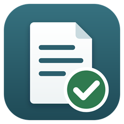

<h1 align="center">BouppteckningsHjälpen</h1>

<b>Gratis hjälp steg för steg när någon nära har dött – från de första dagarna till arvskiftet.</b>

  <a href="https://github.com/antonleigue/BouppteckningsHjalpen/releases/latest"><b>⬇ Ladda ner senaste versionen</b></a>

---

När någon dör finns det mycket som ska ordnas, ofta mitt i sorgen. BouppteckningsHjälpen är ett gratis program för privatpersoner som vill göra bouppteckningen själva. Du behöver inte kunna något om bouppteckning i förväg.

## Det här gör programmet

- **Startguide:** några enkla frågor om den avlidne, familjen, bostaden och ekonomin. Programmet anpassar sedan allt efter er situation.
- **Personlig checklista** med 40-talet steg i sex faser, från dödsfallet till att dödsboet avslutas. Varje steg förklarar *varför* och *hur*.
- **Tidsfrister** räknas ut automatiskt: begravning, förrättning, inlämning till Skatteverket, deklaration och mer. Kan läggas in i kalendern.
- **Vem ärver?** Arvsberäkning enligt ärvdabalken: make/maka, barn, särkullbarn, föräldrar, syskon, laglott och basbeloppsregler.
- **Tillgångar och skulder** med förklaring av hur varje sak värderas, och en ”glöm inte”-lista över sådant som ofta missas.
- **”Klar att skicka?”** kontrollerar bouppteckningen innan den skickas in och varnar för de vanligaste felen.
- **23 färdiga dokument** som fylls i automatiskt: bouppteckning, kallelser med mottagningsbevis, kallelsebevis, fullmakt, följebrev till Skatteverket, anstånd, brev till bank, försäkringsbolag, arbetsgivare och hyresvärd, arvsavstående, bodelning, arvskifte med mera.
- **Hjälp och kunskapsbank:** vanliga frågor, ordlista och kontaktuppgifter till myndigheter.

## Ladda ner

Gå till **[Releases](https://github.com/antonleigue/BouppteckningsHjalpen/releases/latest)** och välj fil:

| Fil | För |
|---|---|
| `BouppteckningsHjalpen-Setup-2.0.0.exe` | Windows 10 och 11 |
| `BouppteckningsHjalpen.apk` | Android-telefoner och surfplattor |

### Installera på Windows

1. Ladda ner och öppna `BouppteckningsHjalpen-Setup-2.0.0.exe`.
2. Om Windows visar *”Windows skyddade datorn”*: klicka på **Mer information** och sedan **Kör ändå**. Varningen visas för att programmet är nytt och inte har ett betalt signeringscertifikat.
3. Följ installationsguiden. Inga administratörsrättigheter behövs.
4. Starta BouppteckningsHjälpen från startmenyn eller skrivbordet.

### Installera på Android

1. Ladda ner `BouppteckningsHjalpen.apk` på telefonen.
2. Öppna filen. Telefonen frågar om du vill tillåta installation från den här källan – tillåt det.
3. Tryck på **Installera**.

## Dina uppgifter stannar hos dig

Allt du skriver in sparas **bara på din egen dator eller telefon**. Ingenting skickas till någon server. Du kan spara en säkerhetskopia som fil och flytta den mellan dator och mobil.

## Viktigt

Informationen bygger på svensk lag (ärvdabalken, äktenskapsbalken, sambolagen) och Skatteverkets anvisningar, kontrollerade **november 2026**. Den är allmän och ersätter inte juridisk rådgivning. Kontrollera alltid aktuella regler på [skatteverket.se/bouppteckning](https://www.skatteverket.se/bouppteckning).

## Villkor

BouppteckningsHjälpen är **gratis** och får användas, kopieras och delas fritt av alla. Det får inte säljas. Programmet tillhandahålls utan garantier.
